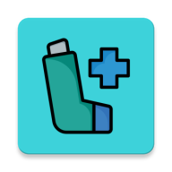
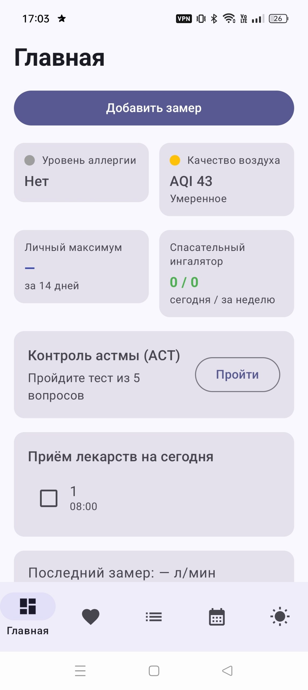
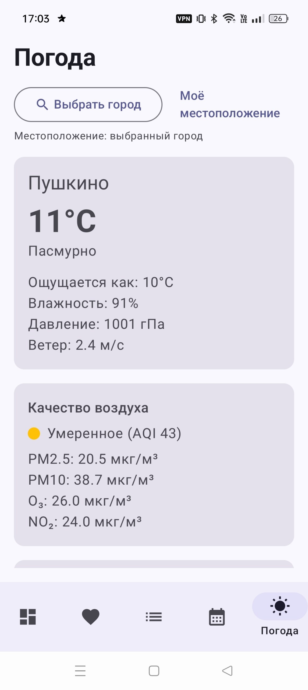
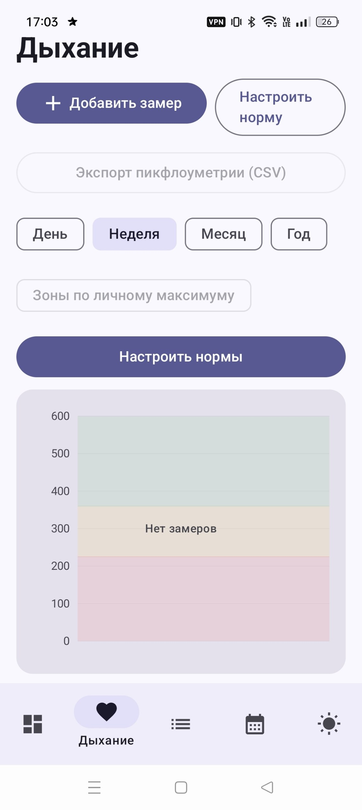
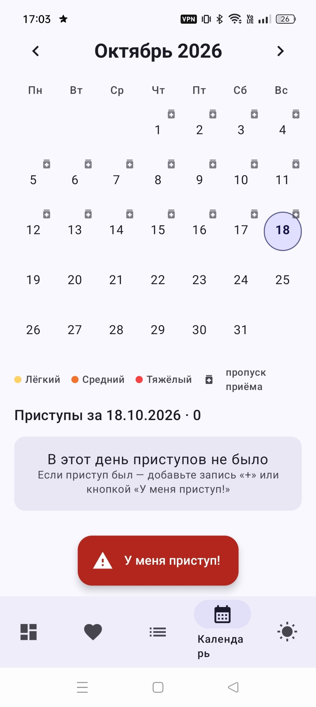
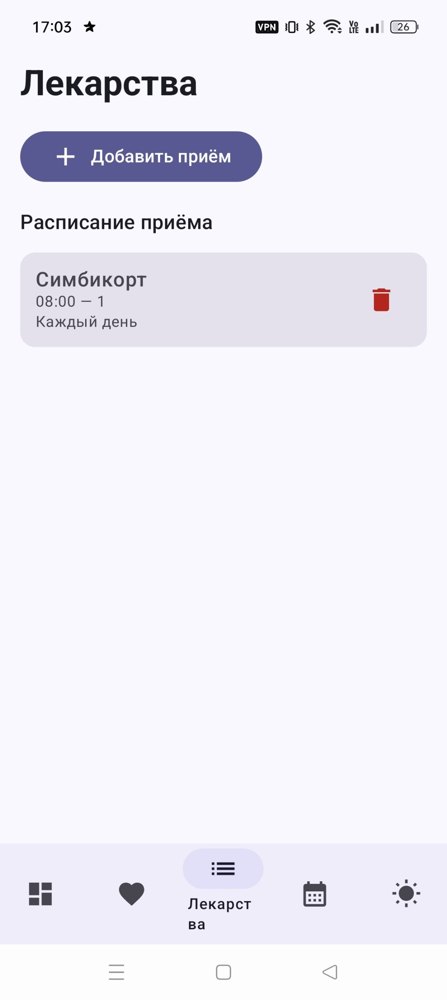
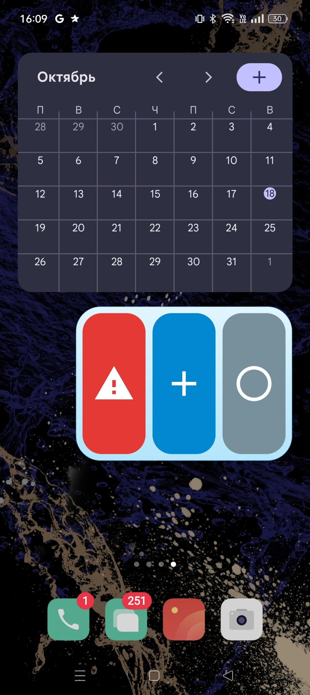

<!-- MARKDOWN LINKS & BADGES -->
[](https://kotlinlang.org/)
[](https://developer.android.com/jetpack/compose)
[](https://m3.material.io/)
[](https://dagger.dev/hilt/)
[](https://developer.android.com/jetpack/androidx/releases/room)
[](https://square.github.io/retrofit/)
[](https://github.com/Zama47/asthma_helper/actions/workflows/ci.yml)
[](https://github.com/Zama47/asthma_helper/releases)
[](LICENSE)

<br>
<div align="center">
  <a href="https://github.com/Zama47/asthma_helper">
    
  </a>

  <h1 align="center">Asthma Helper</h1>
  <p align="center">
    <strong>Ваш персональный помощник в управлении астмой.</strong>
    <br />
    Пикфлоуметрия с клиническими зонами, контроль приёма лекарств, дневник приступов
    и мониторинг качества воздуха — в одном приложении.
    <br />
    <br />
    <a href="https://github.com/Zama47/asthma_helper/releases"><strong>Скачать APK (Pre-release 0.3)</strong></a>
    ·
    <a href="https://github.com/Zama47/asthma_helper/issues"><strong>Сообщить об ошибке</strong></a>
  </p>
</div>
<br />

<details>
  <summary>📖 <strong>Оглавление</strong></summary>
  <ol>
    <li><a href="#-о-проекте">О проекте</a></li>
    <li><a href="#-основные-функции">Основные функции</a></li>
    <li><a href="#-клиническая-логика">Клиническая логика</a></li>
    <li><a href="#-экспорт-данных">Экспорт данных</a></li>
    <li><a href="#-технологический-стек">Технологический стек</a></li>
    <li><a href="#-архитектура-и-структура-проекта">Архитектура и структура проекта</a></li>
    <li><a href="#-качество-и-сборка">Качество и сборка</a></li>
    <li><a href="#-демонстрация-работы">Демонстрация работы</a></li>
    <li><a href="#-планы-по-развитию">Планы по развитию</a></li>
    <li><a href="#-автор">Автор</a></li>
  </ol>
</details>

---

## 📱 О проекте

**Asthma Helper** — Android-приложение для ежедневного контроля бронхиальной астмы. Оно объединяет пять ключевых аспектов управления заболеванием:

- **Дыхание**: трекинг пикфлоуметрии с графиком, клиническими зонами и личным максимумом.
- **Лекарства**: расписание приёма с напоминаниями и отметками о выполнении.
- **Контроль**: опросник ACT и автоматическое предупреждение о начинающемся обострении.
- **Календарь**: дневник приступов с тепловой картой, серией без обострений и SOS-кнопкой.
- **Среда**: погода, качество воздуха и уровень пыльцы, влияющие на самочувствие.

Все данные хранятся **локально на устройстве** (Room) и никуда не отправляются. Из сети загружается только погода и качество воздуха.

---

## ✨ Основные функции

### 🏠 Главный экран
- **Быстрое добавление** замера пикфлоуметрии в один тап.
- **Плитки «Личный максимум» и «Спасательный ингалятор»** (дозы сегодня / за неделю).
- **Карточка контроля астмы (ACT)** с последним результатом и переходом к тесту.
- **Чек-лист приёма лекарств** на сегодня с независимыми отметками.
- **Баннер «Возможно обострение»**, если ПСВ держится ниже 80% личного максимума.
- **Виджеты** уровня аллергенности и качества воздуха (реальные данные Open-Meteo).
- **История записей** с цветными индикаторами по клиническим зонам.

### 🌬️ Дыхание (трекер ПФМ)
- **График динамики** с фоновыми зонами, градиентом, датами по оси X и пунктиром личного максимума.
- **Диаграмма «Утро и вечер по дням»** — суточная вариабельность на одном экране.
- **Переключатель базовой линии**: зоны **по норме** или **по личному максимуму**.
- **Личный максимум за 14 дней** и процент от него для каждого замера.
- **Карточка суточной вариабельности**: `(вечернее − утреннее) / максимум × 100%` с оценкой контроля.
- **Добавление замера** на произвольную дату и время (TimePicker), фильтр по периоду: день / неделя / месяц / год.
- **Настройка нормы**: вручную или автоматический расчёт по формуле (возраст + рост).

### 📋 Контроль астмы (ACT)
- **Опросник из 5 вопросов** по Asthma Control Test, итог 5–25 баллов.
- **Интерпретация уровня**: контроль хороший (≥ 20), частичный (16–19), отсутствует (≤ 15).
- **История результатов** с датами и уровнями.

### 💊 Лекарства
- **Расписание приёма**: время, дозировка и **дни недели**.
- **Готовая база** из **16 предзаполненных популярных препаратов** (Сальбутамол, Будесонид, Серетид и др.).
- **Создание собственных** лекарств с индивидуальными настройками.
- **Умные напоминания** через `WorkManager` (проверка расписаний каждые 15 минут).

### 📅 Календарь приступов
- **Тепловая карта месяца**: приступы цветом по тяжести, пропущенные приёмы лекарств — отдельной иконкой.
- **Серия без обострений (стрик)**: счётчик дней от последнего приступа.
- **Учёт приступов**: дата и время, тяжесть, триггеры, **число доз спасательного ингалятора**, комментарий.
- **SOS-кнопка**: быстрый лог приступа и план первой помощи по рекомендациям GINA.
- **Статистика**: приступы за месяц, в том числе ночные.

### 🌤️ Погода и качество воздуха
- **Текущая погода**: температура, ощущаемая температура, влажность, давление, ветер.
- **Качество воздуха**: европейский индекс AQI (0–100+), концентрация PM2.5, PM10, O₃, NO₂.
- **Реальная пыльца** из Open-Meteo: берёза, ольха, злаки, полынь, амброзия.
- **Персональные рекомендации** на основе AQI, уровня пыльцы и силы ветра.
- **Автоматическое определение местоположения** (FusedLocationProvider) + обратное геокодирование города.
- **Выбор города вручную**: поиск через геокодинг Open-Meteo, выбор сохраняется между запусками.

### 🧩 Виджет домашнего экрана

Три кнопки во всю площадь виджета — без текста, только иконки:

| Кнопка | Действие |
| :--- | :--- |
| 🔴 **Приступ** | Записывает приступ одним тапом — прямо из виджета, приложение не открывается |
| 🔵 **Замер ПСВ** | Открывает приложение с готовым диалогом ввода значения |
| ✅ **Лекарства** | Отмечает приём лекарств на сегодня; серая плитка — не отмечено, зелёная — отмечено |

---

## 🩺 Клиническая логика

Расчёты вынесены в слой `domain/clinical` и покрыты unit-тестами.

| Показатель | Правило |
| :--- | :--- |
| **Личный максимум** | Максимальный ПСВ за последние 14 дней |
| **Процент от максимума** | `текущий ПСВ / личный максимум × 100%` |
| **Зоны (GINA)** | 🟢 ≥ 80% · 🟡 50–79% · 🔴 < 50% |
| **Обострение** | Максимум дня < 80% личного максимума **2 дня подряд**; серия прерывается днём без замеров, устаревшие данные (> 1 дня) игнорируются |
| **Суточная вариабельность** | `(вечер − утро) / максимум × 100%` |
| **ACT** | 5 вопросов × 1–5 баллов; ≥ 20 — хороший контроль, 16–19 — частичный, ≤ 15 — отсутствует |
| **Спасательные дозы** | Сумма доз из записей приступов: за сегодня и за неделю; частое использование подсвечивается |

---

## 📤 Экспорт данных

Экспорт ПСВ в **CSV** через системный «Поделиться» (файл отдаётся через `FileProvider`):

- **Замеры** — все значения с датой и временем, процентом от личного максимума и зоной.
- **Дневные агрегаты** — утренний, вечерний, максимальный и средний ПСВ по дням.
- **Сводный отчёт** — оба блока в одном файле.

Формат оптимизирован под Excel: разделитель `;`, перевод строки CRLF, экранирование кавычками.

---

## 🛠️ Технологический стек

Проект построен на **Kotlin** с использованием современной экосистемы Android.

| Слой | Технологии |
| :--- | :--- |
| **Язык** | [Kotlin 2.2](https://kotlinlang.org/) |
| **UI** | [Jetpack Compose](https://developer.android.com/jetpack/compose), [Material 3](https://m3.material.io/) |
| **Архитектура** | **MVVM** + **Clean Architecture** (слои `data` / `domain` / `ui`) |
| **DI** | [Hilt 2.60.1](https://dagger.dev/hilt/) |
| **БД** | [Room 2.8.4](https://developer.android.com/jetpack/androidx/releases/room) — 7 сущностей, `Flow`-реактивность, схемы в git |
| **Сеть** | [Retrofit 2.11](https://square.github.io/retrofit/) + [OkHttp](https://square.github.io/okhttp/) |
| **Графики** | Собственный рендеринг на Canvas (Jetpack Compose) |
| **Фоновые задачи** | [WorkManager](https://developer.android.com/topic/libraries/architecture/workmanager) + `HiltWorker` |
| **Виджет** | `AppWidgetProvider` + `RemoteViews` |
| **Настройки** | [DataStore Preferences](https://developer.android.com/topic/libraries/architecture/datastore) |
| **Геолокация** | [Google Play Services Location](https://developers.google.com/android/reference/com/google/android/gms/location/package-summary) |
| **Сборка** | [AGP 9.1.1](https://developer.android.com/studio/releases/gradle-plugin), [KSP](https://kotlinlang.org/docs/ksp-overview.html), `compileSdk 37`, `minSdk 24` |

---

## 🧩 Архитектура и структура проекта

Проект организован по принципам **Clean Architecture**, что обеспечивает тестируемость, гибкость и независимость от фреймворков.

```
app/src/main/java/com/example/asthmahelper/
├── data/        # Room, DataStore, Retrofit, реализации репозиториев
├── domain/      # модели, репозитории (интерфейсы), use cases
│   ├── clinical #   личный максимум, зоны, обострения, ACT, спасательные дозы
│   └── export   #   CSV-экспорт ПСВ
├── ui/          # Compose-экраны и ViewModels (dashboard, breathing, act, …)
├── widget/      # AppWidgetProvider домашнего экрана
└── util/        # геолокация, ключи настроек
```

---

## ✅ Качество и сборка

- **41 unit-тест** на клинические расчёты, экспорт CSV и схему БД (`./gradlew testDebugUnitTest`).
- **ktlint** (`ktlintCheck`) и **Android Lint** (`lintDebug`) блокируют сборку в CI.
- **CI** (`.github/workflows/ci.yml`) на каждый PR в `main`: тесты, debug- и release-APK, отчёты.
- **Миграции Room** проверяются тестом на `ALL_MIGRATIONS`, схемы версий лежат в `app/schemas/`.
- **Релиз**: тег `v*` запускает `.github/workflows/release.yml` — подписанный APK и GitHub Release.

Локальные команды:

```bash
./gradlew ktlintCheck          # стиль кода
./gradlew testDebugUnitTest    # unit-тесты
./gradlew assembleDebug        # отладочная сборка
```

Подробности по вкладу — в [CONTRIBUTING.md](CONTRIBUTING.md).

---

## 🎬 Демонстрация работы

Скриншоты версии **0.3** (исходники — в папке [`docs/screenshots/`](docs/screenshots)):

| Главный экран | Погода: качество воздуха и пыльца | Дыхание: график, зоны и экспорт |
|:---:|:---:|:---:|
|  |  |  |

| Календарь приступов | Лекарства | Виджет домашнего экрана |
|:---:|:---:|:---:|
|  |  |  |

---

## 🗺️ Планы по развитию

- [ ] **Публикация в RuStore**: релизная подпись, политика конфиденциальности, карточка приложения
- [ ] **Интеграция с Health Connect**: обмен замерами и приёмами лекарств
- [ ] **Печать отчёта для врача**: PDF-сводка за период вместо CSV
- [ ] **Расширенные уведомления**: настраиваемые интервалы, предупреждение о падении ПСВ
- [ ] **Дневник самочувствия**: симптомы, теги, привязка к замерам ПФМ
- [ ] **Оффлайн-кэш погоды**: последние данные без интернета
- [ ] **Адаптивный дизайн**: планшеты и складные устройства
- [ ] **Мультиязычность**: английский и другие языки

---

## 👤 Автор

**Замышляев Антон Денисович**  

📧 [zama_47@outlook.com](mailto:zama_47@outlook.com)  
📱 [Telegram @Zamaa47](https://t.me/Zamaa47)  
🐙 [GitHub Zama47](https://github.com/Zama47)  
